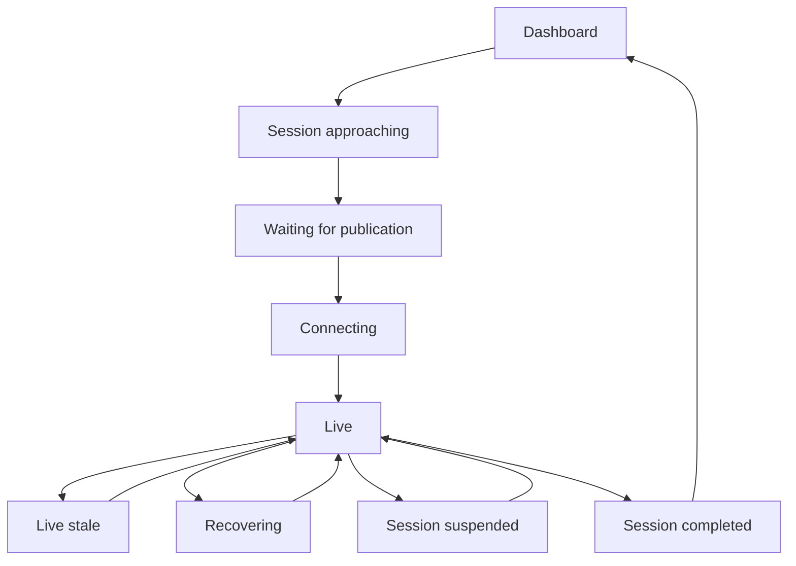

# Autonomous session controller (Milestone 7)

## Architecture and audit

The existing Bridge remains the only normalized LIVE/TEST source and the existing
RealF1Client remains the only live subscription. Its snapshots/deltas, identities,
GPS compatibility lifecycle, interpolation, timing tower and circuit renderer are
reused. Prepared assets are still resolved by the actual live circuit key/season;
no geometry or annotation algorithms/assets change.

Previously the browser opened its race WebSocket only after navigating to Live
Race. App now owns one shared race feed continuously and passes it through LiveRace
and LiveSession. It does not create a second connection when a session opens.
AUTO presentation follows backend lifecycle snapshots; manual navigation remains
available after selecting MANUAL. The existing dashboard's Jolpica weekend schedule
is advisory; new backend discovery combines that metadata with the authenticated
LiveF1 published-session index. TEST processing is never an autonomous source.

`bridge/autonomous.py` contains the deterministic control-plane state machine.
`bridge/controller_service.py` polls metadata asynchronously and serializes source
start/stop through the existing bridge control lock. It does not run an alternate
GPS pipeline. Discovery cannot block current telemetry or manual controls. Existing
LiveF1 reconnect/backoff remains; the controller only starts a source if absent or
its required identity differs. A new source calls the existing stop-before-start
path, preventing duplicate subscriptions. Context changes reset the existing
source generation and GPS safeguards, including the fixes from PR #6.



MANUAL pauses the automatic state machine from every state. Red flag/suspension
never becomes completion based on a timer. Session completion requires matching
provider `Finished`/`Finalised`/`Ended`/`Ends` observations; Finished while red is
conservatively retained as suspension until resumption or Finalised. Ten seconds
and multiple observations debounce provider completion, followed by a 20-second
completion dwell. Schedule duration, chequered TrackStatus alone and GPS silence
do not finalize a session.

## Discovery, evidence and identity

- All practice sessions, Sprint Qualifying/Shootout, Sprint, Qualifying and Race
  are eligible. Paths/keys come from actual provider metadata, never constants.
- UTC schedule metadata comes from the same Jolpica service already used by the
  dashboard. Naive provider times require a published GMT offset, or a matching
  advisory UTC time. Advisory matching uses venue, session type and date/time;
  ambiguous matches do not invent a published identity. UTC/local day differences
  and duplicate provider paths are handled explicitly.
- Approaching starts at one hour; monitoring begins 15 minutes before the advisory
  start. A delayed selected session remains monitored rather than being ended by
  the schedule. Before first selection, candidates are limited to 12 hours past
  start. Late publication polls until a real path becomes available.
- Starting a transport is not LIVE. The actual feed must match the selected path
  (or strong circuit/name/date fallback), and Started/Resumed plus fresh source GPS
  or valid live deltas must be observed. Missing status requires real live deltas;
  an Inactive snapshot never becomes LIVE from its receipt clock alone.
- Snapshot receipt time is not treated as a live delta. GPS uses native Utc epoch
  milliseconds and the existing bounded 7.5-second default LIVE age; accepted live
  timing/car deltas have a 15-second receipt window. GPS missing with other active
  telemetry displays LIVE_STALE. Marker freshness remains the animation engine's
  independent per-driver safeguard; no stale position is labelled fresh.
- Matching new eligible provider identity triggers source revalidation. Red flags,
  no GPS and connection loss retain the race view; no archived session is loaded.

Sources: LiveF1's authenticated season Index.json metadata and
`https://api.jolpi.ca/ergast/f1/<year>.json?limit=100`.
These are data APIs, not promises that every session is published in advance.

## AUTO / MANUAL and recovery

AUTO is the initial default. Explicit mode choice persists in
`circuit-assets/controller.json` using the existing bounded Windows atomic writer.
The file stores operating mode, completed provider paths, a bounded metadata catalog and transition
history; it contains no credentials or telemetry. After a backend restart, active
tracking approval and GPS buffers are not restored from disk: actual identity and
fresh telemetry must be reacquired. Completed paths prevent reconnecting to the
same already-finished session. A browser refresh receives the current controller
state with the normal snapshot.

The controller has a bounded spawn retry policy: exponential delay capped at
60 seconds, with a five-minute cooldown after eight attempts for the selection.
Metadata retries back off from 30 seconds to a bounded interval. LiveF1's existing
transport has its own capped reconnect loop. No rapid loops or infinite queues
are introduced. A lost browser socket reconnects through the existing transport;
the backend continues independently. Source, discovery and browser tasks have
explicit shutdown cleanup.

Every manual LIVE start/stop or historical playback action sets MANUAL first.
Explicit AUTO selection while TEST is loaded is rejected, preserving TEST. Switch
to LIVE deliberately, then choose AUTO. Opening `/dev` exposes controls but does
not itself change mode or start playback. Switching back to AUTO revalidates the
source; it does not assume the manually viewed session is the desired next one.

## Circuit assets and missing data

The controller checks prepared asset availability asynchronously once per circuit
identity and at a bounded retry interval. It avoids repeatedly publishing unchanged
assets, which would otherwise reset frontend geometry/compatibility state. The
original public Austin reference is protected. The frontend still performs its own
normal asset lookup and GPS compatibility validation.

Missing assets are reported in controller diagnostics while timing/live ingestion
continue. Expensive automatic geometry reconstruction during an active session is
**deferred**, not run on the ingestion loop or repeatedly retried. The existing
background preparation API/season command remains available between sessions;
this milestone does not silently prepare an upcoming session with no archived
laps, substitute another layout, or compete with live telemetry for CPU/memory.

## Windows startup

Stop previous backend/Vite processes with Ctrl+C, then pull the stacked feature branch:

```powershell
git fetch origin
git switch feat/autonomous-session-controller
git pull --ff-only origin feat/autonomous-session-controller
```

For unattended AUTO (explicitly overrides a persisted MANUAL preference):

```powershell
.\.venv\Scripts\python.exe -m bridge.server --auto --login
```

In another terminal:

```powershell
npm run dev
```

Open `http://localhost:5173/wall` for the read-only display. Use browser fullscreen
(F11) if desired. No development controls appear on that route; source/waiting
indicators remain. This is fullscreen-ready web presentation, not hardware boot
provisioning or an OS kiosk installation.

Open `http://localhost:5173/dev` for AUTO/MANUAL selection, lifecycle diagnostics,
manual LIVE controls and existing diagnostics. To retain historical controls:

```powershell
.\.venv\Scripts\python.exe -m bridge.server --manual --idle --allow-test --login
```

The public wall follows the same backend mode; a deliberate developer override
also overrides the wall. No hardware-specific deployment has been implemented.
No FastF1 dependency is added to the live backend. Existing assets/caches need no
regeneration or migration.

## Deterministic local simulation

```powershell
.\.venv\Scripts\python.exe -m bridge.autonomous --simulate
```

This runs immediately with simulated clocks: Practice 1, Qualifying and Race each
exercise Dashboard → Approaching → Waiting for publication → Connecting → LIVE →
Recovery → LIVE → Red flag suspension → LIVE → Confirmed completion → Dashboard.
Every JSON line is explicitly `simulation: true` with SIMULATION identities.
It does not authenticate, access network/storage, connect a live source, generate
GPS, or inject mock race data into the production browser. It validates the control
plane only. It is not an end-to-end graphical playback or proof of real LIVE
service availability. Existing real TEST clips remain the renderer/animation test.

## Diagnostics and remaining verification

Backend snapshots/status messages expose operating mode, state/view, upcoming and
selected metadata, reason, UTC transition history, discovery success/error/backoff,
last accepted telemetry time, subscription attempts, completion reason and asset
availability/identity. Backend timestamps in controller diagnostics are UTC seconds;
GPS diagnostics retain their documented epoch-millisecond/monotonic distinction.
Only safe exception categories are exposed; no tokens, raw provider error bodies
or credentials appear in controller files/messages.

Deterministic tests cover normal/sprint sequences, publication delays, Inactive
snapshots, red/resume/finalise, stale/outage recovery, no countdown finalization,
identity mismatch, completion/restart memory, TEST isolation, mode persistence,
UTC conversion/duplicate metadata, bounded retries, new feed identity, missing
assets and nonblocking discovery. Browser tests cover authoritative AUTO views,
refresh snapshots and a shared-feed wall render without development controls.
Existing LIVE GPS, TEST, registry, labels, sectors and season suites remain intact.

Real authenticated autonomous session switching, recovery, local prepared layouts
and 16:9 visual fit still require a local soak test. There is no live-race success
claim from simulation. Provider metadata/schedule outages can delay discovery;
a session without a confirmed completion message conservatively remains stale or
recovering instead of guessing it ended. Credential renewal may still require
local authentication under the existing LiveF1 mechanism. Missing assets are not
built during active telemetry. The recommended next milestone is an authenticated
weekend soak/fault-injection test, then supervised device startup/restart setup.

A connected source with unconfirmed session metadata is refreshed at most once a
minute after the scheduled start, within the same eight-attempt/cooldown budget.
Likewise, a matching Started/Resumed session with over a minute of actual telemetry
silence can be refreshed; red-flag quiet periods do not trigger this path. These
bounded refreshes recover an incomplete new-session delta or a stalled subscription
without restarting a healthy source on each tick. Discovery is once per minute
near an eligible session and once per ten minutes otherwise, with bounded error
backoff. Unchanged prepared asset content is not repeatedly rebroadcast during
these checks, preserving the GPS compatibility history.

The read-only metadata probe in this environment retrieved 115 advisory sessions
with UTC times (all supported practice/sprint/qualifying/race types). The LiveF1
index returned authentication-required. This confirms advisory parsing only, not
real identity validation or an autonomous live session. A bounded metadata catalog
is retained for restart monitoring, but never restores active tracking approval;
an actual matching source and fresh telemetry are still required.
