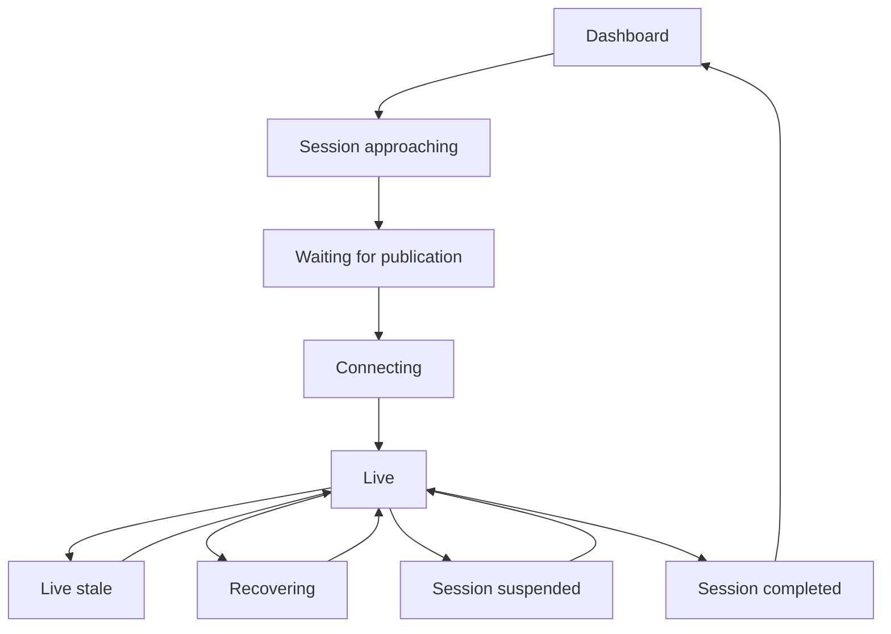

# Autonomous session controller (Milestone 7)

## Architecture and audit

The existing Bridge remains the only normalized LIVE/TEST source and the existing
RealF1Client remains the only live subscription. Its snapshots/deltas, identities,
GPS compatibility lifecycle, interpolation, timing tower and circuit renderer are
reused. Prepared assets are still resolved by the actual live circuit key/season;
no geometry or annotation algorithms/assets change.

Previously the browser opened its race WebSocket only after navigating to Live
Race. App now owns one shared race feed continuously and passes it through LiveRace
and LiveSession. It does not create a second connection when a session opens.
AUTO presentation follows backend lifecycle snapshots; manual navigation remains
available after selecting MANUAL. The existing dashboard's Jolpica weekend schedule
is advisory; new backend discovery combines that metadata with the authenticated
LiveF1 published-session index. TEST processing is never an autonomous source.

`bridge/autonomous.py` contains the deterministic control-plane state machine.
`bridge/controller_service.py` polls metadata asynchronously and serializes source
start/stop through the existing bridge control lock. It does not run an alternate
GPS pipeline. Discovery cannot block current telemetry or manual controls. Existing
LiveF1 reconnect/backoff remains; the controller only starts a source if absent or
its required identity differs. A new source calls the existing stop-before-start
path, preventing duplicate subscriptions. Context changes reset the existing
source generation and GPS safeguards, including the fixes from PR #6.



MANUAL pauses the automatic state machine from every state. Red flag/suspension
never becomes completion based on a timer. Session completion requires matching
provider `Finished`/`Finalised`/`Ended`/`Ends` observations; Finished while red is
conservatively retained as suspension until resumption or Finalised. Ten seconds
and multiple observations debounce provider completion, followed by a 20-second
completion dwell. Schedule duration, chequered TrackStatus alone and GPS silence
do not finalize a session.

## Discovery, evidence and identity

- All practice sessions, Sprint Qualifying/Shootout, Sprint, Qualifying and Race
  are eligible. Paths/keys come from actual provider metadata, never constants.
- UTC schedule metadata comes from the same Jolpica service already used by the
  dashboard. Naive provider times require a published GMT offset, or a matching
  advisory UTC time. Advisory matching uses venue, session type and date/time;
  ambiguous matches do not invent a published identity. UTC/local day differences
  and duplicate provider paths are handled explicitly.
- Approaching starts at one hour; monitoring begins 15 minutes before the advisory
  start. A delayed selected session remains monitored rather than being ended by
  the schedule. Before first selection, candidates are limited to 12 hours past
  start. Late publication polls until a real path becomes available.
- Starting a transport is not LIVE. The actual feed must match the selected path
  (or strong circuit/name/date fallback), and Started/Resumed plus fresh source GPS
  or valid live deltas must be observed. Missing status requires real live deltas;
  an Inactive snapshot never becomes LIVE from its receipt clock alone.
- Snapshot receipt time is not treated as a live delta. GPS uses native Utc epoch
  milliseconds and the existing bounded 7.5-second default LIVE age; accepted live
  timing/car deltas have a 15-second receipt window. GPS missing with other active
  telemetry displays LIVE_STALE. Marker freshness remains the animation engine's
  independent per-driver safeguard; no stale position is labelled fresh.
- Matching new eligible provider identity triggers source revalidation. Red flags,
  no GPS and connection loss retain the race view; no archived session is loaded.

Sources: LiveF1's authenticated season Index.json metadata and
`https://api.jolpi.ca/ergast/f1/<year>.json?limit=100`.
These are data APIs, not promises that every session is published in advance.

## AUTO / MANUAL and recovery

AUTO is the initial default. Explicit mode choice persists in
`circuit-assets/controller.json` using the existing bounded Windows atomic writer.
The file stores operating mode, completed provider paths, a bounded metadata catalog and transition
history; it contains no credentials or telemetry. After a backend restart, active
tracking approval and GPS buffers are not restored from disk: actual identity and
fresh telemetry must be reacquired. Completed paths prevent reconnecting to the
same already-finished session. A browser refresh receives the current controller
state with the normal snapshot.

The controller has a bounded spawn retry policy: exponential delay capped at
60 seconds, with a five-minute cooldown after eight attempts for the selection.
Metadata retries back off from 30 seconds to a bounded interval. LiveF1's existing
transport has its own capped reconnect loop. No rapid loops or infinite queues
are introduced. A lost browser socket reconnects through the existing transport;
the backend continues independently. Source, discovery and browser tasks have
explicit shutdown cleanup.

Every manual LIVE start/stop or historical playback action sets MANUAL first.
Explicit AUTO selection while TEST is loaded is rejected, preserving TEST. Switch
to LIVE deliberately, then choose AUTO. Opening `/dev` exposes controls but does
not itself change mode or start playback. Switching back to AUTO revalidates the
source; it does not assume the manually viewed session is the desired next one.

## Circuit assets and missing data

The controller checks prepared asset availability asynchronously once per circuit
identity and at a bounded retry interval. It avoids repeatedly publishing unchanged
assets, which would otherwise reset frontend geometry/compatibility state. The
original public Austin reference is protected. The frontend still performs its own
normal asset lookup and GPS compatibility validation.

Missing assets are reported in controller diagnostics while timing/live ingestion
continue. Expensive automatic geometry reconstruction during an active session is
**deferred**, not run on the ingestion loop or repeatedly retried. The existing
background preparation API/season command remains available between sessions;
this milestone does not silently prepare an upcoming session with no archived
laps, substitute another layout, or compete with live telemetry for CPU/memory.

## Windows startup

Stop previous backend/Vite processes with Ctrl+C, then pull the stacked feature branch:

```powershell
git fetch origin
git switch feat/autonomous-session-controller
git pull --ff-only origin feat/autonomous-session-controller
```

For unattended AUTO (explicitly overrides a persisted MANUAL preference):

```powershell
.\.venv\Scripts\python.exe -m bridge.server --auto --login
```

In another terminal:

```powershell
npm run dev
```

Open `http://localhost:5173/wall` for the read-only display. Use browser fullscreen
(F11) if desired. No development controls appear on that route; source/waiting
indicators remain. This is fullscreen-ready web presentation, not hardware boot
provisioning or an OS kiosk installation.

Open `http://localhost:5173/dev` for AUTO/MANUAL selection, lifecycle diagnostics,
manual LIVE controls and existing diagnostics. To retain historical controls:

```powershell
.\.venv\Scripts\python.exe -m bridge.server --manual --idle --allow-test --login
```

The public wall follows the same backend mode; a deliberate developer override
also overrides the wall. No hardware-specific deployment has been implemented.
No FastF1 dependency is added to the live backend. Existing assets/caches need no
regeneration or migration.

## Deterministic local simulation

```powershell
.\.venv\Scripts\python.exe -m bridge.autonomous --simulate
```

This runs immediately with simulated clocks: Practice 1, Qualifying and Race each
exercise Dashboard → Approaching → Waiting for publication → Connecting → LIVE →
Recovery → LIVE → Red flag suspension → LIVE → Confirmed completion → Dashboard.
Every JSON line is explicitly `simulation: true` with SIMULATION identities.
It does not authenticate, access network/storage, connect a live source, generate
GPS, or inject mock race data into the production browser. It validates the control
plane only. It is not an end-to-end graphical playback or proof of real LIVE
service availability. Existing real TEST clips remain the renderer/animation test.

## Diagnostics and remaining verification

Backend snapshots/status messages expose operating mode, state/view, upcoming and
selected metadata, reason, UTC transition history, discovery success/error/backoff,
last accepted telemetry time, subscription attempts, completion reason and asset
availability/identity. Backend timestamps in controller diagnostics are UTC seconds;
GPS diagnostics retain their documented epoch-millisecond/monotonic distinction.
Only safe exception categories are exposed; no tokens, raw provider error bodies
or credentials appear in controller files/messages.

Deterministic tests cover normal/sprint sequences, publication delays, Inactive
snapshots, red/resume/finalise, stale/outage recovery, no countdown finalization,
identity mismatch, completion/restart memory, TEST isolation, mode persistence,
UTC conversion/duplicate metadata, bounded retries, new feed identity, missing
assets and nonblocking discovery. Browser tests cover authoritative AUTO views,
refresh snapshots and a shared-feed wall render without development controls.
Existing LIVE GPS, TEST, registry, labels, sectors and season suites remain intact.

Real authenticated autonomous session switching, recovery, local prepared layouts
and 16:9 visual fit still require a local soak test. There is no live-race success
claim from simulation. Provider metadata/schedule outages can delay discovery;
a session without a confirmed completion message conservatively remains stale or
recovering instead of guessing it ended. Credential renewal may still require
local authentication under the existing LiveF1 mechanism. Missing assets are not
built during active telemetry. The recommended next milestone is an authenticated
weekend soak/fault-injection test, then supervised device startup/restart setup.

A connected source with unconfirmed session metadata is refreshed at most once a
minute after the scheduled start, within the same eight-attempt/cooldown budget.
Likewise, a matching Started/Resumed session with over a minute of actual telemetry
silence can be refreshed; red-flag quiet periods do not trigger this path. These
bounded refreshes recover an incomplete new-session delta or a stalled subscription
without restarting a healthy source on each tick. Discovery is once per minute
near an eligible session and once per ten minutes otherwise, with bounded error
backoff. Unchanged prepared asset content is not repeatedly rebroadcast during
these checks, preserving the GPS compatibility history.

The read-only metadata probe in this environment retrieved 115 advisory sessions
with UTC times (all supported practice/sprint/qualifying/race types). The LiveF1
index returned authentication-required. This confirms advisory parsing only, not
real identity validation or an autonomous live session. A bounded metadata catalog
is retained for restart monitoring, but never restores active tracking approval;
an actual matching source and fresh telemetry are still required.

## Las Vegas wall switching regression

Confirmed code paths (synthetic reproduction, not authenticated race observation):

1. `--auto` correctly overrides a persisted MANUAL checkpoint at startup. However,
   pressing Start LIVE in `/dev` deliberately switches the shared backend to
   MANUAL. Previously `/wall` then used its own per-tab manual navigation default
   (`dashboard`), even while `/dev` displayed the shared working live feed. Wall
   now mirrors the backend's requested manual LIVE session; developer navigation
   remains independent. It never mirrors TEST. This view choice is not a claim
   that GPS is fresh: the existing waiting/stale/identity/calibration guards stay.
2. AUTO could remain on a path-less advisory when published metadata used a
   different locality label and had no copied advisory ID. Advisory correlation
   now permits exact normalized event-name agreement as well as locality, with
   matching session type/time proximity and a unique provider candidate. It still
   requires actual provider identity and fresh telemetry before AUTO enters LIVE.
   Ambiguous or unrelated events are not adopted. GMT offsets and UTC/local date
   boundaries retain their existing interpretation; no countdown-based activation.
3. RaceState's internal session-reset snapshot did not contain the controller
   snapshot and could temporarily erase presentation state in React. It now
   carries the backend control plane without changing telemetry/GPS timestamps.
   Controller transitions also publish a status envelope immediately on the same
   existing WebSocket, in addition to reconnect snapshots/periodic heartbeats.

The user's exact runtime trigger cannot be established without their current
controller diagnostics. These reproducible paths are corrected; neither a zero
countdown nor successful mock tests establishes real LIVE validation.

### Windows validation

Stop the old backend and Vite processes (Ctrl+C) so only one backend owns port 8765:

```powershell
git fetch origin
git switch feat/production-live-ui-cleanup
git pull --ff-only origin feat/production-live-ui-cleanup
.\.venv\Scripts\python.exe -m bridge.server --auto --login
```

In another terminal: `npm run dev`. Open http://localhost:5173/wall and hard-refresh
with Ctrl+F5. Do not press Start LIVE or load TEST to initiate normal AUTO operation.
The wall should switch only after the backend validates the published session and
fresh real telemetry. Existing locally prepared Vegas assets are untouched.

For optional inspection open http://localhost:5173/dev without changing modes.
The controller diagnostics should show `mode: AUTO`, a real selected session path,
`state: LIVE` (or LIVE_STALE/recovery), `view: live`, and `feedEvidence` containing
`dataMode: LIVE`, the provider session path/status, identity confirmation and source
running state. Discovery timestamps/errors explain publication or authentication
waits. `reason` explains every transition. No need to delete controller.json,
regenerate Vegas, reset caches, or keep `/dev` open.

If you intentionally press Start LIVE in `/dev`, backend mode becomes MANUAL;
`manualPresentation: live` makes the wall mirror it while retaining manual source
ownership. Its normal disconnected/stale/waiting indicators still apply. Stop LIVE
clears that presentation. TEST stays isolated. To return to unattended AUTO, switch
back to LIVE if in TEST, then explicitly select AUTO; or restart using `--auto`.

Confirmed provider completion (debounced by AUTO) returns the wall to Dashboard.
Red flags and temporary telemetry loss do not count as completion. In MANUAL, an
explicit end status returns the wall to Dashboard (red-flag Finished remains live
until finalised); this does not enable automatic source management in MANUAL.

Regression tests cover a published synthetic Vegas Race at the UTC/local date
boundary with fresh GPS, a prior unmatched advisory, explicit AUTO over persisted
MANUAL, immediate status/snapshot propagation, actual wall App rendering despite
an expired zero-countdown fixture, shared manual LIVE, TEST isolation, mismatched
identities, ambiguous metadata, red flags, completion and session-reset clocks.
Actual authenticated wall switching must still be observed locally. If it remains
on Dashboard, copy only the `/dev` Session controller diagnostics JSON (no tokens,
raw telemetry or account details) so the remaining runtime cause can be identified.

## Confirmed path-less Vegas advisory with a working feed

The supplied local diagnostics establish a different, specific failure: AUTO
selected a Race advisory with `path: null`, while the existing LIVE source had
real `SessionInfo.Path` and status Started. The path-less branch returned before
examining an alternative provider identity. Discovery read the yearly archive
index only; realtime SessionInfo was not a source of candidates. In addition,
`combine_schedule` excludes index records with unusable start/GMT metadata unless
an advisory can be matched. An absent/late index entry and an excluded untimed
entry were previously indistinguishable. The exact upstream omission requires
local catalog counts; it is not inferred from the identityConfirmed flag.

AUTO now reconciles that narrow case through `live_reconciliation.py`:

- Require LIVE mode, a connected running source, current Started/Resumed status,
  existing identity confirmation **and** fresh measured GPS or accepted live
  timing/telemetry deltas. None of these booleans alone is approval.
- Require raw provider SessionInfo with concrete session/meeting/circuit keys,
  circuit and meeting names, session type, a canonical relative provider path,
  target/current year, valid local/path dates and UTC/GMT start alignment. Match
  the selected advisory's event/type/year/time and any explicit circuit/meeting
  identity. A manually selected expected path is never a source of identity.
- Independently corroborate with a complete matching raw year-index entry
  (including session key, now retained by list_sessions). An entry with missing
  GMT may still corroborate an identical literal StartDate; its timezone is not
  guessed. The current provider feed must supply a valid time basis.
- Otherwise query that session's authenticated Index.json and its **declared**
  SessionInfo StreamPath. Merge at most 128 metadata records / 1 MiB, then compare
  its keys/type/path/date/start/circuit against the live feed. No GPS archive,
  whole session download, fabricated path or different session is substituted.
- Conflicting/ambiguous catalog entries, missing metadata, stale data, wrong dates,
  manual/TEST mode and previously completed sessions remain blocked. Endpoint
  failure stays blocked with sanitized errors and 30–300 second backoff.
- Metadata requests run off the event loop, not under a blocking network wait.
  Mode/session changes invalidate pending work. Successful reconciliation binds
  the verified identity to the **existing** source without stop/start, a second
  LiveF1 subscription or another WebSocket. Normal completion, red flags, stale
  GPS and runtime circuit compatibility retain their existing safeguards.

`reconciliation.status: verified-current-provider-session` means provider session
identity was reconciled; it does not mark circuit geometry/annotations verified.
With fresh GPS, controller state becomes LIVE and view becomes live; with only
fresh timing evidence, LIVE_STALE still presents the race while GPS remains gated.

### Pull, restart and verify locally

Stop the old backend and frontend with Ctrl+C. Do not delete controller history,
regenerate Vegas or enable TEST for this check:

```powershell
git fetch origin
git switch feat/production-live-ui-cleanup
git pull --ff-only origin feat/production-live-ui-cleanup
.\.venv\Scripts\python.exe -m bridge.server --auto --login
```

In another terminal run `npm run dev`, open http://localhost:5173/wall and hard
refresh with Ctrl+F5. Do not press Start LIVE in /dev to initiate AUTO. If a real
feed is already running when AUTO is selected, it can now be adopted after the
same independent checks rather than restarted. `/dev` may be opened read-only
for diagnostics and does not need to stay open.

Inspect Session controller diagnostics:

- `selected.path`: the actual provider Race directory, rather than null.
- `state`: LIVE / LIVE_STALE; `view`: live.
- `reconciliation.status`: verified-current-provider-session; `source` identifies
  year-index or independent-session-metadata. Blocked cases include an exact
  non-sensitive reason, rather than inferring success from countdown or flags.
- `catalogDiagnostics.feedPathEntries` vs `feedPathEntriesWithUsableStart`:
  zero entries means the raw current index did not supply that path; entries
  without usable start reveal time-metadata exclusion. These are raw-year-index
  counts, distinct from controllerPathCandidates.
- `providerIdentityCheck.state`: year-index-confirmed, checking, received or
  unavailable, with retry timing/sanitized errors. Received alone is not approval;
  reconciliation must validate the returned document against the current feed.

Tests use the user-supplied Vegas path with synthetic keys/GPS/statuses. They
exercise the exact missing-candidate condition, independent corroboration, raw
untimed index records, absent/conflicting identities, UTC/local dates, stale GPS,
manual/TEST isolation, completion, backoff, cancellation and wall status rendering.
They do not establish authenticated LIVE visual success. If the race has ended,
AUTO correctly stays/returns on Dashboard; validate during the next real active
session rather than treating the expired countdown as evidence.


Cold-start detail: when the yearly catalog still lacks the advisory's path, AUTO
may open the existing single current LiveF1 subscription for **observation** during
the normal monitoring window. It does not select a guessed session path or present
LIVE on connection/countdown alone. It remains on Dashboard until all independent
identity and freshness checks above pass. This allows the same reconciliation to
work after pulling/restarting, when there is no pre-existing feed to adopt. Failed
observers share the existing bounded connection retry/cooldown budget; a running
observer is not duplicated. An unrelated, ended or incomplete provider session
remains unapproved. No manual Start LIVE step is required for this bootstrap.

## Metadata authentication versus the working LIVE connection

The installed LiveF1 1.3 SDK uses `login(...).header` for SignalR and can renew a
rejected token. The old archive helper used only `auth_header()`, which silently
returns empty when the shared token is expired/missing, and never renewed it.
An established LIVE socket can continue while a new REST request lacks a usable
token. Both paths use the same SDK cache/configuration; the archive did not have
an intentionally separate account. Its other defect was labelling **all** 403s
as authentication-required, including denials with an Authorization header.
The supplied old diagnostics therefore cannot establish whether it was a 401,
missing Bearer, or an authorized 403.

`archive_auth.py` now reuses the SDK token, and obtains renewal through public
`livef1.auth.login` with explicit already-configured local credentials. Pinned SDK
read-only env-path helpers preserve livef1.configure/env-file precedence; no new
credential store is introduced. Missing credentials do not trigger background
prompts. A lock, global refresh cooldown and one request retry bound renewal.
401 rejection can refresh once; 403 without a token can obtain authentication.
403 **with** a token is access-denied (as in the SDK REST policy), not proof that
another sign-in fixes entitlement or a currently unavailable endpoint. It stays
blocked. No public-data substitution or relaxed identity checks are introduced.

Requests use the LIVE SDK's BestHTTP profile, standard timeouts, and no automatic
redirect forwarding. Verification diagnostics export only endpoint kind, HTTP
status, whether auth was attached, refresh attempted/succeeded and safe numeric
cache/server-clock information. No JWT, password, cookie, account identifier,
credential filename, raw request/response header or body is exported. Renewing a
REST token does not disconnect/restart the existing LIVE subscription.

The controller's yearly index lookup has no disk/index cache; the season batch's
24-hour cache is a different path. The reported `feedPathEntries: 0` was already
before combine_schedule's time filtering, so that filter cannot explain that
particular missing path. list_sessions only removes records with no Path. New
`indexRequestDiagnostics` shows raw entry/pathless counts and request timing.
Index requests ask no-cache revalidation and use a changing query nonce. These
are requests, not guarantees that a provider/CDN honored them; safe cache Age/
HIT/MISS indicators help distinguish a stale upstream response. If a newly fetched
index still lacks the Race while direct metadata works, publication/index lag
remains the explanation to investigate; do not invent a path or claim it proved.

### Safe Windows probe and validation

After pulling this branch, run this locally from the repository. It reads only
metadata, creates no subscription, changes no circuit assets and prints sanitized
JSON. Use the exact path in your feedEvidence:

```powershell
git fetch origin
git switch feat/production-live-ui-cleanup
git pull --ff-only origin feat/production-live-ui-cleanup
.\.venv\Scripts\python.exe -m bridge.metadata_probe --year 2026 --event "Las Vegas" --path "2026/2026-11-21_Las_Vegas_Grand_Prix/2026-11-21_Race/" --login
```

If a 401 persists and renewal cannot use stored local credentials, explicitly
refresh locally (do not paste credentials/tokens into chat):

```powershell
.\.venv\Scripts\python.exe -c "import livef1; livef1.login(force=True)"
```

Then restart the backend with `--auto --login`, keep the normal Vite frontend and
hard-refresh `/wall`. `/dev` may be opened read-only to inspect:

- `indexRequestDiagnostics`: current HTTP result, auth attached, cache requests,
  server cache hints, raw entry/pathless counts and fetchedAt.
- `providerIdentityCheck.requestDiagnostics`: whether rejection happened at the
  per-session index or SessionInfo stream, HTTP status/auth/refresh evidence.
- HTTP 200 + valid independent identity + fresh actual telemetry must precede
  reconciliation approval and LIVE/view live. A 200 alone is not approval.
- `archive-access-denied` / 403 with auth means the provider still denied that
  endpoint. Keep AUTO waiting; do not repeat login indefinitely or weaken checks.
  The real cause may be entitlement, endpoint policy or unpublished resources;
  this code cannot distinguish those from status alone.

Tests simulate expired/missing/rejected/shared credentials, successful renewal,
authorized 403, no-prompt behavior, bounded retries, safe reports, pathless index
entries and authenticated LIVE + REST denial. Real account authorization and
provider publication still require this local probe; tests are not LIVE proof.
